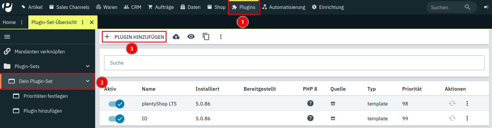
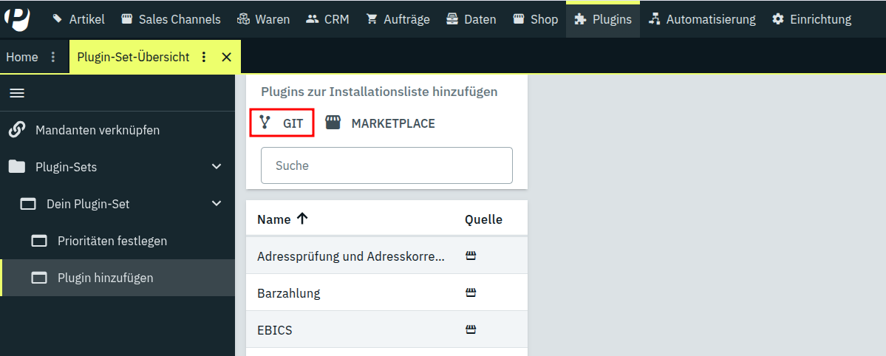
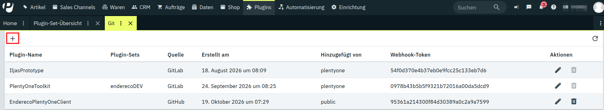
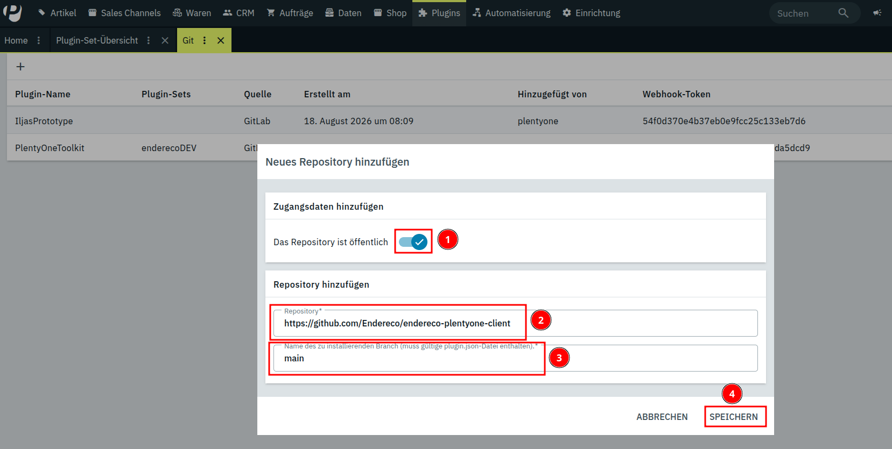
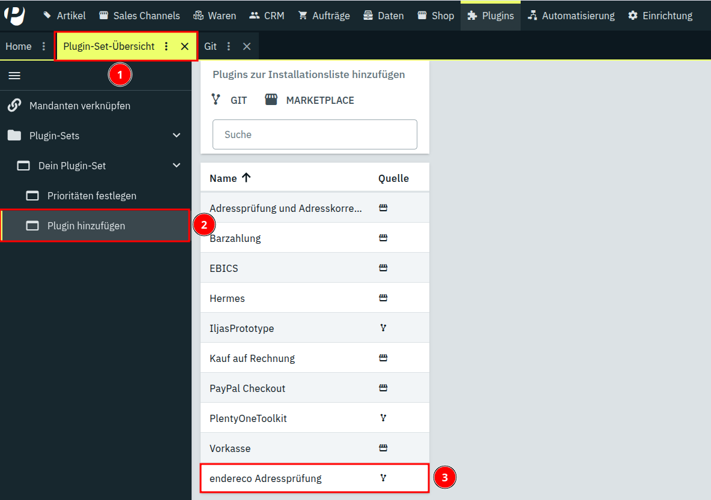
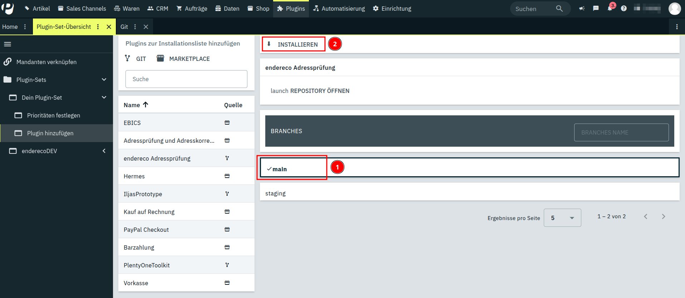
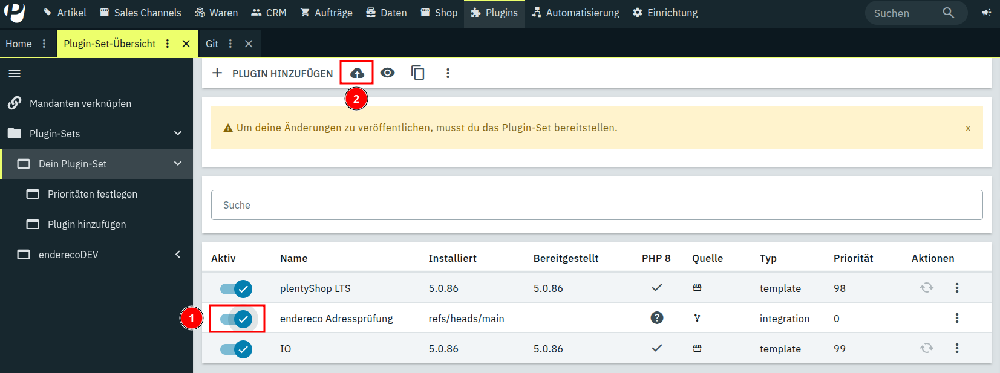
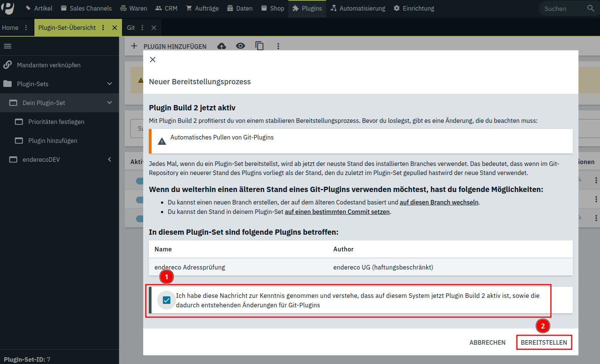

# Installation über GitHub

Solange das Plugin noch nicht über den PlentyONE Marketplace verfügbar ist, kann es direkt aus dem GitHub-Repository in ein Plugin-Set installiert werden.

Repository-URL: `https://github.com/Endereco/endereco-plentyone-client`

## 1. Plugin hinzufügen öffnen

Navigiere zu deinem Plugin-Set und wähle **Plugin hinzufügen**.



## 2. GIT als Quelle wählen

Wähle im Bereich „Plugins zur Installationsliste hinzufügen“ **GIT** als Quelle.



## 3. Neues Git-Repository hinzufügen

Es öffnet sich der Tab **Git**. Füge dort über das **+** Symbol ein neues Git-Repository hinzu.



## 4. Repository-URL eintragen

Wähle **Das Repository ist öffentlich**, trage die URL des Repositories ein und wähle als Branch **main** aus:

```
https://github.com/Endereco/endereco-plentyone-client
```



## 5. Plugin auswählen

Gehe zurück zu **Plugin hinzufügen** und wähle aus der Liste **endereco Adressprüfung** aus.



## 6. Branch wählen und installieren

Wähle unter **Branches** den Branch **main** und klicke auf **Installieren**.



> **Hinweis:** Es kann sein, dass PlentyONE im Hintergrund noch nicht bereit ist und eine Fehlermeldung erscheint. Warte in diesem Fall kurz und versuche es erneut.

## 7. Plugin aktivieren und Plugin-Set bereitstellen

Aktiviere in deinem Plugin-Set das Plugin **endereco Adressprüfung** und stelle das Plugin-Set über das Wolken-Symbol bereit.



## 8. Plugin Build 2 bestätigen

Bestätige die Verwendung von Plugin Build 2 und klicke auf **Bereitstellen**.



## 9. Bei der ersten Installation erneut bereitstellen

Wiederhole bei der ersten Installation das Bereitstellen des Plugin-Sets (Schritt 7). So ist sichergestellt, dass alles, was das Plugin benötigt, vollständig in deinem PlentyONE-System angelegt wurde.

## Wie geht es weiter?

Die Einrichtung und Konfiguration des Plugins ist in der [Benutzeranleitung](../meta/documents/user_guide_de.md) beschrieben.
