# endereco Adressprüfung

Falsche Lieferadressen kosten Arbeit, und zwar immer erst später: beim Erstellen
des Labels, bei der Retoure, manchmal schon beim Übertragen in das
Warenwirtschaftssystem. Dieses Plugin prüft die Lieferadresse jedes Auftrags
international, trägt eindeutige Korrekturen selbst ein und markiert die
Aufträge, die manuell durch einen Mitarbeiter nachkorrigiert werden müssen –
für reibungslosere Abläufe und weniger Retouren.

Die Adresse deines Kunden im CRM wird dabei nie verändert, korrigiert wird
ausschließlich die Lieferadresse des Auftrags. Das Anlegen des Auftrags wartet
nicht auf das Ergebnis der Prüfung – die läuft danach unabhängig im Hintergrund.
Der Auftrag bleibt dabei nur für einen kurzen Augenblick, in aller Regel
wenige Minuten, auf seinem Prüfstatus: ein Bruchteil der Zeit, die eine falsch
adressierte Sendung später kosten würde.

## Funktionsumfang

* Internationale Adressprüfung – nicht nur auf deutsche Adressen beschränkt.
* Automatische Übernahme sicherer, eindeutiger Korrekturen an Straße, Ort,
  Postleitzahl, Zusatzzeile und Bundesland.
* Der Auftrag wird während der Prüfung angehalten und danach automatisch auf
  einen Status gesetzt, den du für jedes Ergebnis einzeln festlegen kannst –
  oder auf den Status zurück, den er vorher hatte.
* Es werden Tags am Auftrag angelegt, an denen du das Ergebnis in der
  Auftragsübersicht siehst.
* Ein Kommentar am Auftrag mit dem Ergebnis der Prüfung im Klartext –
  optional abschaltbar. Hier wird transparent dokumentiert, was genau
  korrigiert wurde.
* Das vollständige Ergebnis wird ebenfalls in den Auftragseigenschaften
  angezeigt – auch als Rückweg, falls du eine Korrektur zurücknehmen willst.
* Bausteine für Automation → Flow: du kannst selbst bestimmen, wann geprüft
  wird, und damit auch einen bereits geprüften Auftrag gezielt erneut prüfen
  lassen, etwa nach einer manuellen Adresskorrektur.

Und das alles selbstverständlich DSGVO-konform.

## Erste Schritte und Voraussetzungen

Du brauchst zweierlei:

1. **Einen API-Schlüssel von endereco.** Diesen kannst du kostenfrei unter
   [endereco.de/apikey-beantragen](https://www.endereco.de/apikey-beantragen/)
   beantragen.
2. **Ein Plugin-Set, das mit einem Mandanten verknüpft ist.** Sinnvoll ist
   hier meist der Standard Mandant. Ohne diese Verknüpfung läuft kein
   Plugin-Code – weder der Cronjob noch die Reaktion auf neue Aufträge.

> **Achtung:** Wenn nach der Installation nichts passiert, prüfe zuerst
> unter **Plugins → Plugin-Set-Übersicht**, ob dein Plugin-Set mit einem
> Mandanten verknüpft ist. Das ist die häufigste Ursache und in keiner
> Fehlermeldung zu sehen.

**So richtest du das Plugin ein:**

1. Installiere das Plugin in deinem Plugin-Set und stelle das Plugin-Set
   neu bereit.
2. **Stelle das Plugin-Set erneut ein zweites Mal bereit.** Das ist keine
   Vorsichtsmaßnahme: PlentyONE führt die Einrichtungsschritte eines Plugins
   bei der ersten Bereitstellung nach der Installation nicht aus. Ohne den
   zweiten Durchgang fehlen dem Plugin seine Tabelle und Auftragseigenschaften,
   und im Log stehen Fehlermeldungen über eine fehlende Tabelle.
3. Öffne **Plugins → Plugin-Sets**, klicke auf den Namen deines Sets und darin
   auf das Plugin, hier findest du im linken Bereich den Punkt
   **Konfiguration**.
4. Trage im Tab **endereco-Schnittstelle** deinen API-Schlüssel ein und
   speichere.

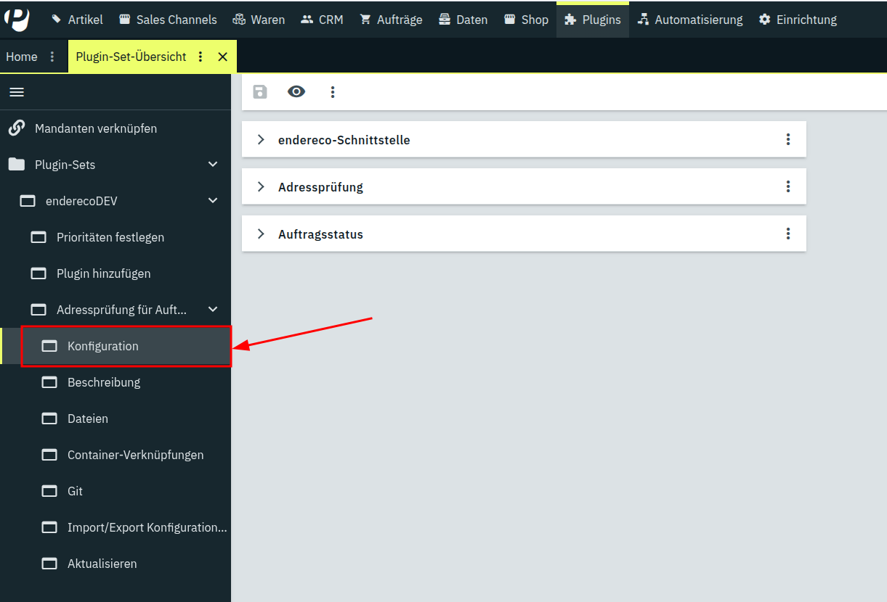

## Plugin-Konfiguration

**Tab „endereco-Schnittstelle"**

| Einstellung | Standard | Bedeutung |
|---|---|---|
| **Adresse des endereco-Dienstes** | `https://endereco-service.de/rpc/v1` | Bleibt normalerweise unverändert. |
| **API-Schlüssel** | leer | Dein API-Schlüssel von endereco. Pflichtfeld. |

**Tab „Adressprüfung"**

| Einstellung | Standard | Bedeutung |
|---|---|---|
| **Verarbeitung** | Normal | Zum Stummschalten des Plugins, ohne es im Plugin-Set zu deaktivieren: bei „Auslaufen lassen" oder „Komplett anhalten" bleibt die Flow-Aktion des Plugins nutzbar, tut aber nichts – Flows, die sie verwenden, brechen dadurch nicht, anders als bei einer vollständigen Deaktivierung. „Auslaufen lassen" arbeitet die Warteschlange noch ab, „Komplett anhalten" friert beides sofort ein. |
| **Wann sollen Aufträge zur Prüfung vorgemerkt werden?** | Sofort, wenn ein Auftrag eingeht | Alternativ nur über einen Flow, den du selbst einrichtest. In beiden Fällen bleibt die Flow-Aktion zusätzlich nutzbar. |
| **Kleine Korrekturen automatisch übernehmen** | ein | Trägt eindeutige, kleine Korrekturen direkt in die Lieferadresse ein – siehe Hinweis weiter unten, was als „klein" gilt. |
| **Ergebnis als Kommentar am Auftrag festhalten** | ein | Schreibt bei jeder abgeschlossenen Prüfung einen Kommentar mit dem Ergebnis in die Auftragsnotizen. |
| **Benutzer-ID für Kommentare** | 1 | Numerische ID eines Backend-Benutzers, unter dem der Ergebniskommentar am Auftrag erscheint. Ohne gültige ID wird kein Kommentar geschrieben. Eine Benutzer-ID mit Admin Rechten ist empfehlenswert. |

> **Hinweis:** Aufträge, die während „Auslaufen lassen" oder „Komplett
> anhalten" eingehen, werden nicht automatisch zur Prüfung vorgemerkt – auch
> nicht nachträglich, wenn du später wieder auf „Normal" umstellst. Es gibt
> keinen automatischen Nachlauf, der übersehene Aufträge aufgreift. Willst
> du solche Aufträge doch noch prüfen lassen, musst du sie selbst über einen
> Flow mit der Aktion „Auftrag zur Adressprüfung vormerken" nachträglich
> vormerken.

**Tab „Auftragsstatus"**

| Einstellung | Standard | Bedeutung |
|---|---|---|
| **Status: Warten auf Adressprüfung** | 3.2 (In Warteposition) | Status, den der Auftrag ab dem Einreihen in die Warteschlange zur Prüfung bekommt. |
| **Zielstatus: Adresse korrekt** | 0 (vorheriger Status) | Auftragsstatus, wenn die Adresse als korrekt bestätigt wurde. |
| **Zielstatus: kleine Korrektur übernommen** | 0 (vorheriger Status) | Auftragsstatus, wenn eine sichere, kleine Korrektur automatisch übernommen wurde. |
| **Zielstatus: Korrekturvorschlag/-vorschläge vorhanden** | 0 (vorheriger Status) | Auftragsstatus, wenn ein oder mehrere Korrekturvorschläge existieren, aber nicht automatisch übernommen wurden – egal ob genau einer zu unsicher dafür ist oder mehrere mögliche Adressen gefunden wurden. |
| **Zielstatus: keine Adresse gefunden** | 0 (vorheriger Status) | Auftragsstatus, wenn endereco keinen Korrekturvorschlag machen konnte. |

> **Hinweis:** „Status: Warten auf Adressprüfung" ist kein Auslöser für die
> Prüfung – das Plugin setzt ihn selbst, sobald ein Auftrag in die
> Warteschlange kommt, nicht umgekehrt. Willst du, dass ein bestimmter
> Auftragsstatus eine Prüfung auslöst, richte dafür einen Flow ein (siehe
> „Erweiterte Nutzung" weiter unten).

> **Hinweis:** „0" bedeutet bei jedem Zielstatus dasselbe: den Status
> wiederherstellen, den der Auftrag vor der Prüfung hatte. Existiert eine
> eingetragene Status-ID auf deinem System nicht (mehr), passiert automatisch
> dasselbe – der vorherige Status wird wiederhergestellt, nichts bleibt
> hängen.

## Wie ein Auftrag in die Warteschlange kommt

Es gibt zwei Wege, wie ein Auftrag in die Warteschlange des Plugins gelangt:

* **Automatisch, wenn der Auftrag eingeht** – der Standardfall, gesteuert über
  die Einstellung „Wann sollen Aufträge zur Prüfung vorgemerkt werden?" (Tab
  „Adressprüfung"). Jeder neue Verkaufsauftrag mit Lieferadresse wird direkt
  beim Anlegen vorgemerkt.
* **Über einen Flow, per Aktion „Auftrag zur Adressprüfung vormerken"** – du
  entscheidest selbst, wann geprüft wird, zum Beispiel erst nach
  Zahlungseingang (siehe „Erweiterte Nutzung" weiter unten). Diese Aktion
  funktioniert außerdem auch für einen Auftrag, den das Plugin bereits
  abgeschlossen hat – die automatische Vormerkung dagegen greift
  grundsätzlich nur einmal beim Anlegen des Auftrags.

In beiden Fällen passiert dasselbe: das Plugin merkt den Auftrag vor, hält ihn
auf dem konfigurierten Start-Status an (Standard: *3.2 | In Warteposition*)
und setzt das Tag **Address validation pending**. Ein Auftrag, an dem gerade
schon eine Prüfung läuft, wird dabei nicht ein zweites Mal vorgemerkt,
unabhängig davon, wodurch die Vormerkung ausgelöst wurde.

## So läuft eine Prüfung ab

Sobald ein Auftrag vorgemerkt ist, läuft die Prüfung identisch weiter – unabhängig
davon, wie er in die Warteschlange kam:

1. Ein Cronjob arbeitet die Warteschlange automatisch im Fünf-Minuten-Takt ab
   und holt sich dabei bis zu 50 vorgemerkte Aufträge, die er einzeln prüft.
2. Das Ergebnis landet am Auftrag: Tags, Eigenschaften, ein Kommentar (sofern
   gewünscht) und – wenn nötig und erlaubt – die korrigierte Lieferadresse.
   Konnte die Adresse bei z. B. fehlender Hausnummer nicht korrigiert werden,
   so wird dies ebenfalls in den Auftragsnotizen vermerkt.
3. Der Auftrag bekommt den für dieses Ergebnis konfigurierten Zielstatus.

> **Hinweis:** Die Prüfung läuft also nicht sofort bei Eingang des Auftrags,
> sondern spätestens innerhalb der nächsten fünf Minuten. Mit bis zu 50 Aufträgen pro 
> Durchlauf verarbeitet das Plugin bis zu 600 Aufträge pro Stunde, kontrolliert, ohne dein
> System zu überlasten – auch bei einem starken Bestellaufkommen, etwa im
> Weihnachtsgeschäft, oder wenn auf einen Schlag viele Aufträge importiert
> werden.

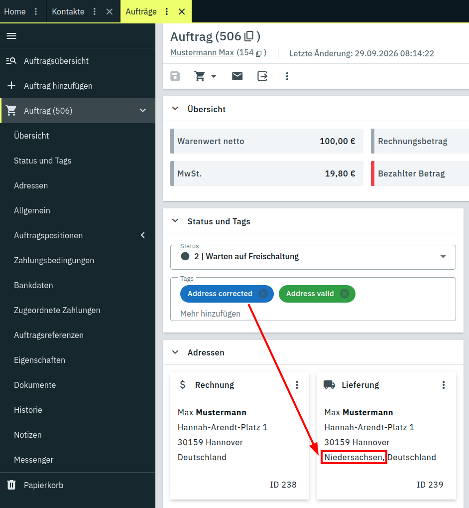

| Ergebnis | Tags am Auftrag | Lieferadresse | Zielstatus (Standard) |
|---|---|---|---|
| Adresse war korrekt | **Address valid** | unverändert | vorheriger Status |
| Eindeutige Korrektur, übernommen | **Address valid** + **Address corrected** | korrigiert | vorheriger Status |
| Korrektur vorhanden, nicht übernommen (Haken nicht gesetzt, Korrektur nicht eindeutig genug, oder mehrere mögliche Adressen gefunden) | **Address has issues** | unverändert | vorheriger Status |
| Keine sinnvolle Korrektur möglich | **Address has issues** | unverändert | vorheriger Status |
| Adressprüfung gescheitert, alle Versuche verbraucht | **Address validation failed** | unverändert | vorheriger Status |

> **Hinweis:** Tags werden in PlentyONE unabhängig von der Sprache des
> Backends immer in englisch angezeigt, obwohl das Plugin auch deutsche
> Übersetzungen mitliefert – eine Einschränkung von PlentyONE selbst. Dieser
> Guide nennt die Tags deshalb durchgehend englisch, so wie du sie auch in
> einem deutschsprachigen Backend siehst.

> **Hinweis:** Automatisch korrigiert wird nur, was ohne Aufsicht korrigierbar
> ist: genau ein Vorschlag und nur ein kleiner, eindeutiger Fehler – etwa eine
> andere Schreibweise („Lindenstraße 5" zu „Lindenstr. 5"), ein einzelner
> fehlender Buchstabe oder eine einzelne falsche Ziffer in der Postleitzahl.

### Der Kommentar am Auftrag

Ist die Einstellung „Ergebnis als Kommentar am Auftrag festhalten"
aktiv, hinterlässt das Plugin nach jeder abgeschlossenen Prüfung einen
internen Kommentar (nicht für den Kunden sichtbar) mit dem Ergebnis im
Klartext, zum Beispiel:

* *„endereco-Adressprüfung: Adresse korrekt."*
* *„endereco-Adressprüfung: Adresse automatisch korrigiert."*
* *„endereco-Adressprüfung: Adresse konnte nicht automatisch korrigiert
  werden."* – mit dem Korrekturvorschlag oder dem Grund darunter, etwa
  „Hausnummer fehlt."

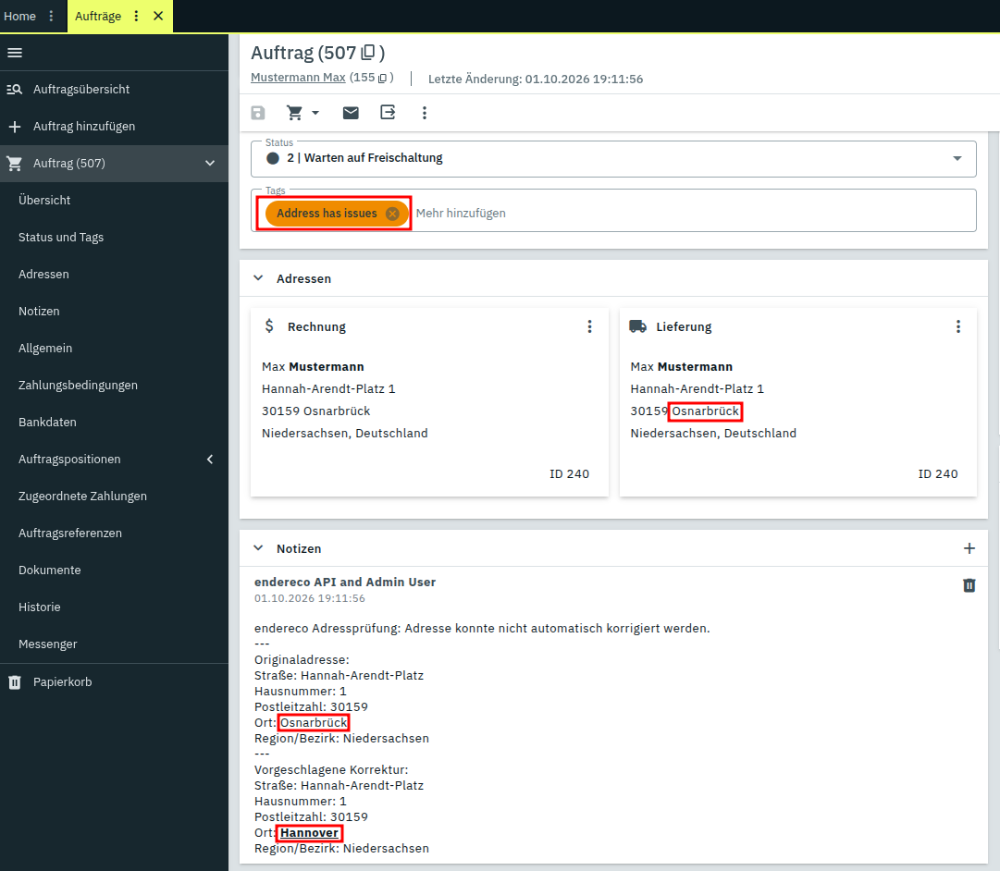

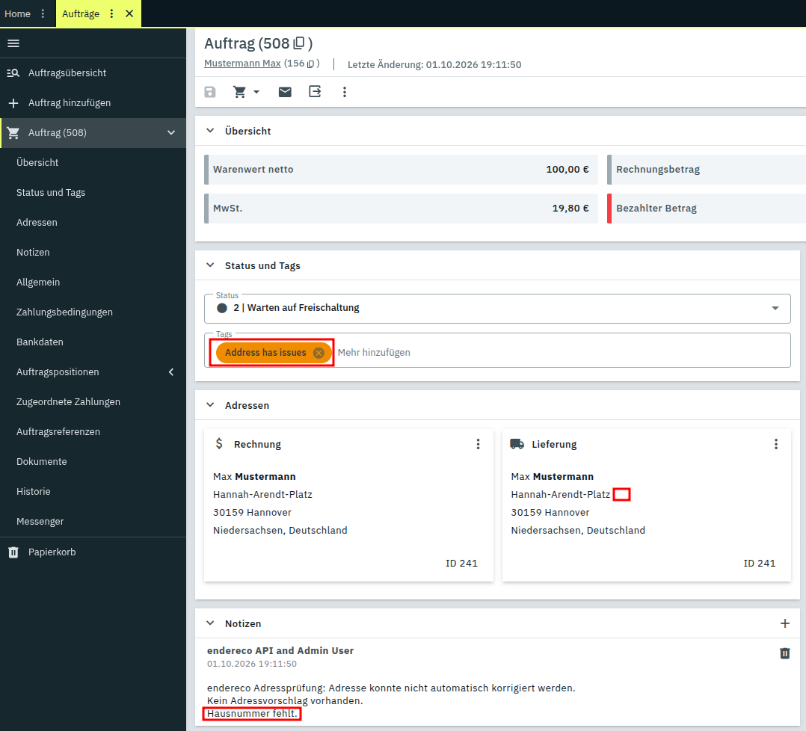

### Was am Auftrag stehen bleibt

Unter **Eigenschaften** direkt am Auftrag findest du das vollständige Ergebnis. Die Adressfelder
stehen paarweise – der Wert vor der Prüfung und der vorgeschlagene Wert
direkt untereinander.

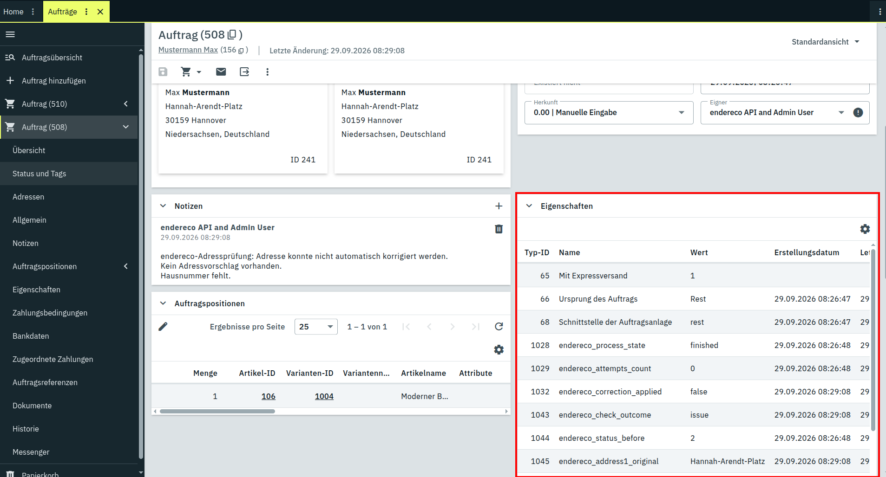

| Eigenschaft | Inhalt |
|---|---|
| `endereco_process_state` | `enqueued`, `checked` oder `finished` – internes Feld für den Ablauf, kein Ergebnis |
| `endereco_check_outcome` | `correct`, `corrected`, `issue` oder `failed` |
| `endereco_correction_applied` | ob eine Korrektur eingetragen wurde |
| `endereco_attempts_count` | Anzahl der erfolglosen Versuche – bleibt in der Regel bei `0` |
| `endereco_status_before` | der Auftragsstatus vor der Prüfung |
| `endereco_address1_original` / `_suggestion` | Straße vorher und vorgeschlagen |
| `endereco_address2_original` / `_suggestion` | Hausnummer vorher und vorgeschlagen |
| `endereco_address3_original` / `_suggestion` | Adresszusatz vorher und vorgeschlagen |
| `endereco_address4_original` / `_suggestion` | freies Zusatzfeld vorher und vorgeschlagen |
| `endereco_postal_code_original` / `_suggestion` | Postleitzahl vorher und vorgeschlagen |
| `endereco_town_original` / `_suggestion` | Ort vorher und vorgeschlagen |
| `endereco_subdivision_original` / `_suggestion` | Bundesland/Region als ISO-Code |

> **Hinweis:** Die Felder mit `_original` sind dein Rückweg: dort steht die
> Adresse, wie sie vor der Korrektur war. Du kannst sie jederzeit von Hand
> oder über einen Flow zurückschreiben. Gab es keinen Vorschlag (z. B. bei
> „keine Adresse gefunden"), steht in den `_suggestion`-Feldern `none`; gab es
> mehrere mögliche Adressen, steht dort `multiple`.

## Erweiterte Nutzung: was mit Flows sonst noch möglich ist

Die Flow-Integration ist bewusst offen gehalten – die Aktion **Auftrag zur
Adressprüfung vormerken** lässt sich mit jedem Auslöser und jeder anderen
Aktion kombinieren, die Plenty Flow sonst noch bietet. Die folgenden zwei
Beispiele sind typische Anwendungsfälle, aber nur ein Ausschnitt dessen, was
damit denkbar ist.

### Beispiel: Prüfung erst nach Zahlungseingang

Du willst nur Aufträge prüfen, die wirklich versendet werden? Dann lege
den Zeitpunkt selbst fest.

1. Stelle **Wann sollen Aufträge zur Prüfung vorgemerkt werden?** auf
   *Nur über einen Flow, den du selbst einrichtest*.
2. Öffne **Automatisierung → Flow Studio**, klicke auf das **+**-Symbol und
   wähle *Neuen Flow erstellen*.

   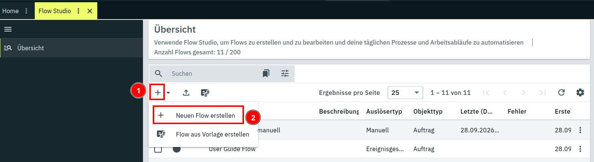

3. Gib dem Flow einen Namen, etwa *Adressprüfung nach Zahlungseingang*.

   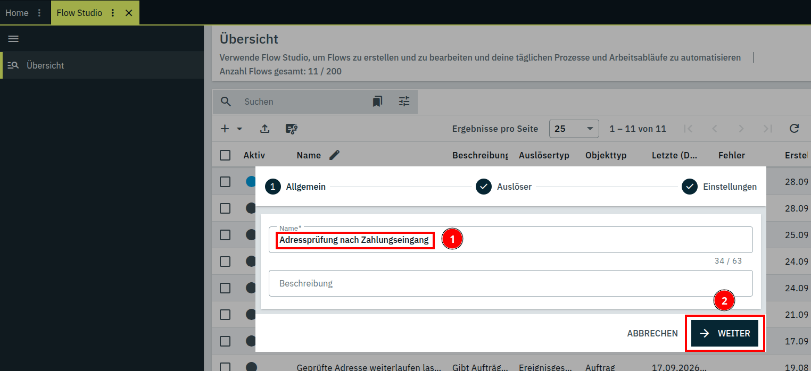

4. Wähle als Auslöser **Ereignisgesteuert**.

   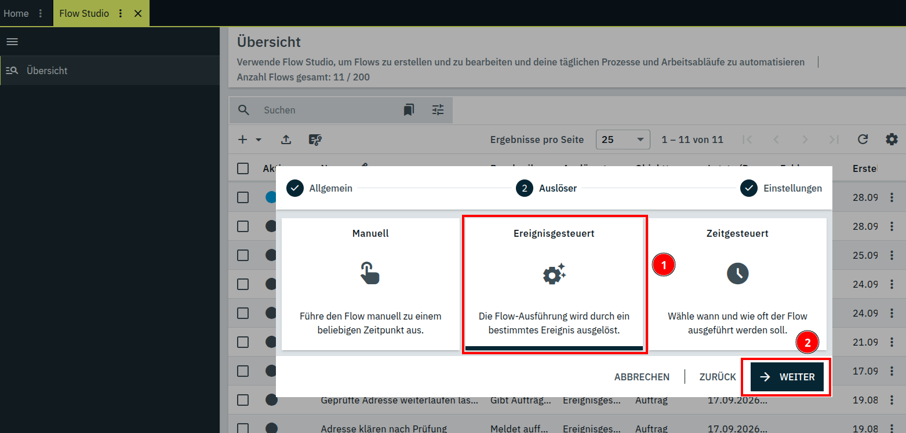

5. Wähle im nächsten Schritt unter **Ereignisauswahl** den Eintrag
   **Zahlungsstatus**. Darunter erscheint ein zweites Feld, in dem du
   **Vollständig** auswählst – das ist der Status „vollständig bezahlt".

   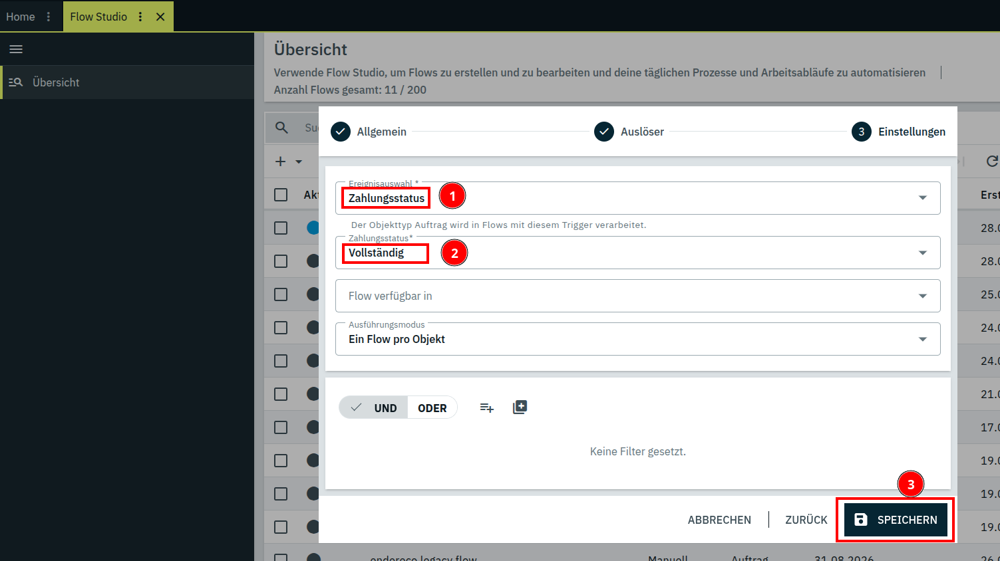

6. Ziehe aus der Palette die Aktion **Auftrag zur Adressprüfung vormerken**
   auf die Zeichenfläche. Am schnellsten findest du sie über das Suchfeld der
   Palette.

   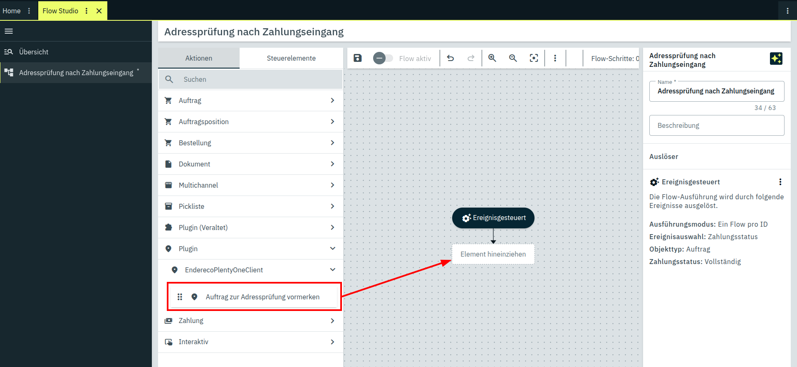

7. Speichere den Flow und schalte ihn mit **Flow aktiv** ein.

   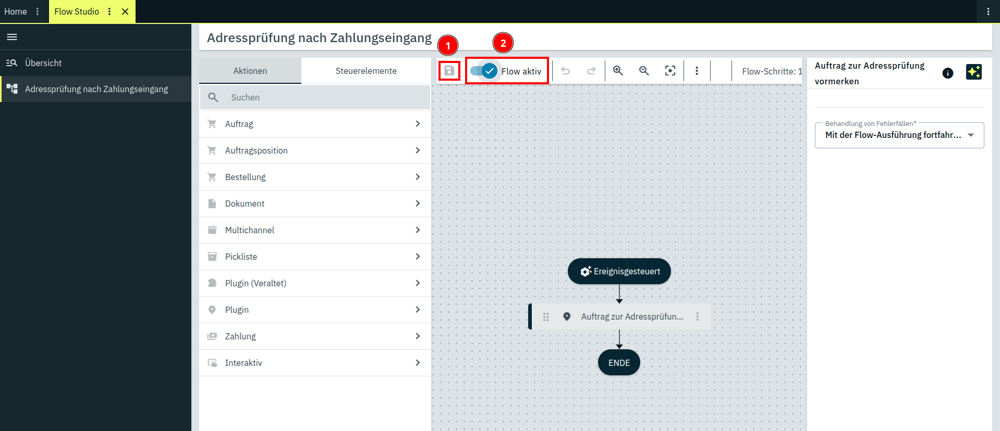

### Beispiel: einen bereits geprüften Auftrag erneut prüfen lassen

Anders als die automatische Vormerkung bei Auftragseingang – die einen Auftrag
grundsätzlich nur einmal aufgreift – lässt sich dieselbe Flow-Aktion
**Auftrag zur Adressprüfung vormerken** auch auf einen Auftrag anwenden, den
das Plugin bereits abgeschlossen hat. Praktisch, wenn du eine Adresse von
Hand korrigiert hast und das Ergebnis danach noch einmal geprüft haben
möchtest. Diesmal per manuellem Auslöser, den du direkt am Auftrag auslöst –
an der Einstellung „Wann sollen Aufträge zur Prüfung vorgemerkt werden?" musst
du dafür nichts ändern.

1. Öffne **Automatisierung → Flow Studio**, klicke auf das **+**-Symbol und
   wähle *Neuen Flow erstellen*.

   

2. Gib dem Flow einen Namen, etwa *Adresse manuell erneut prüfen*.

   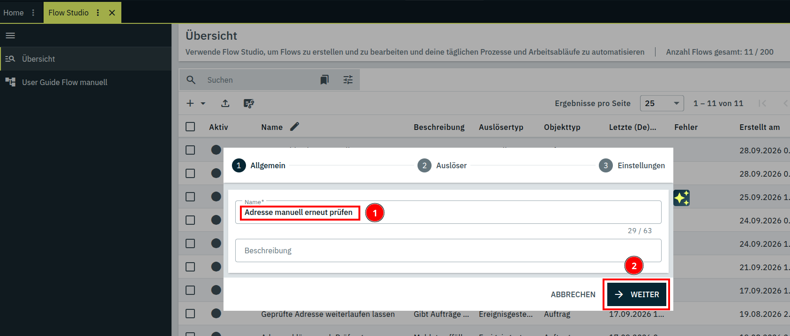

3. Wähle als Auslöser **Manuell**.

   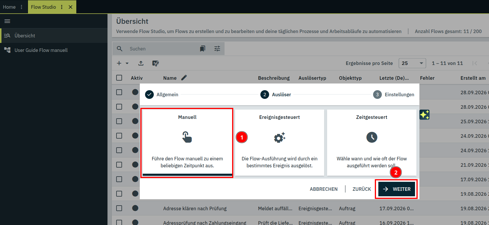

4. Setze unter **Flow verfügbar in** die Haken bei **Auftrags-UI** und
   **Nachbestellung-UI** – beide lassen sich gleichzeitig aktivieren, je
   nachdem, wo du den Flow später manuell auslösen willst.

   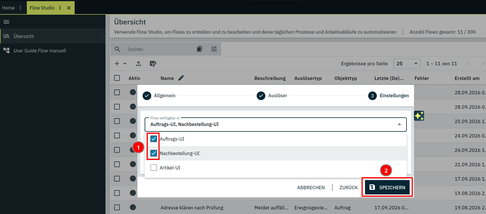

5. Ziehe aus der Palette die Aktion **Auftrag zur Adressprüfung vormerken**
   auf die Zeichenfläche.

   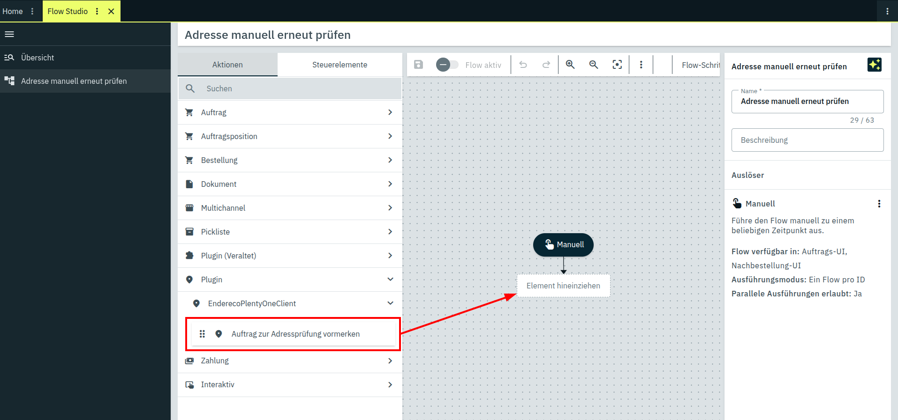

6. Speichere den Flow und schalte ihn mit **Flow aktiv** ein.

   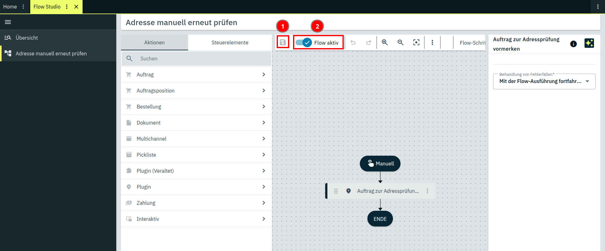

Ab jetzt lässt sich der Flow direkt am Auftrag manuell auslösen.

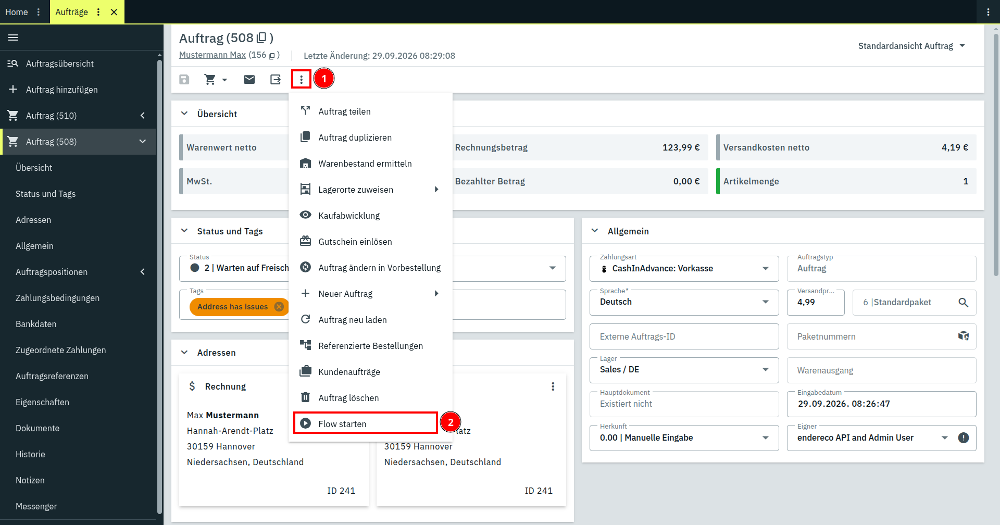

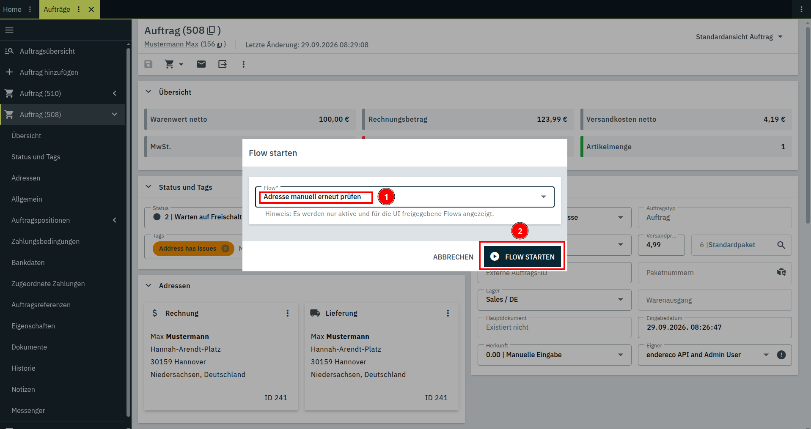

## Abrechnung

Abgerechnet wird jeder Aufruf, der tatsächlich geprüft wird – unabhängig
davon, was die Antwort dann aussagt (korrekt, korrigierbar, mehrdeutig,
nicht gefunden zählen alle gleich). Versuche, die nicht durchkommen –
falscher API-Schlüssel, Zeitüberschreitung – kosten nichts, auch nicht
beim wiederholten Versuch.
Ein Auftrag, bei dem die Prüfung nach 3 Versuchen aufgegeben wird
(**Address validation failed**), wurde also gar nicht abgerechnet.

Die aktuellen Preise findest du unter [endereco.de/preise](https://www.endereco.de/preise/).

## Was das Plugin nicht tut

* Es baut keine Oberfläche zum Abarbeiten der auffälligen Adressen. Diese
  Fälle bekommen einen Tag, eine Eigenschaft und einen Kommentar, alles
  Weitere entscheidest du – zum Beispiel über einen eigenen Flow auf Basis
  der Tags. Eine Übersicht kannst du dir erstellen, indem du dir im Dashboard
  den festgelegten Status mit den entsprechenden nicht korrigierbaren
  Adressen anzeigen lässt.
* Es prüft eine Adresse nicht automatisch erneut, wenn sie sich nachträglich
  ändert – dafür gibt es die Flow-Aktion zum erneuten Vormerken.
* Es verändert niemals die Adresse deines Kunden im CRM, lediglich die
  Lieferadresse am Auftrag.

## Support

Fragen zur Einrichtung und zum Dienst: [support@endereco.de](mailto:support@endereco.de),
Telefon +49 (0) 931 – 663 98 39-0. Weitere Kontaktdaten stehen im Support-Tab.
