# endereco address validation

Incorrect delivery addresses cost work, and always only later: when
creating the shipping label, on a return, sometimes already when
transferring the order into the ERP system. This plugin checks every
order's delivery address internationally, writes back unambiguous
corrections itself, and flags the orders that need manual follow-up by
a staff member - for smoother processes and fewer returns.

Your customer's address in the CRM is never touched - only the order's
delivery address is corrected. Creating the order never waits for the
check's result - it runs independently in the background afterwards.
The order only sits on its check status for a brief moment, usually a
few minutes: a fraction of the time a wrongly addressed shipment would
otherwise cost later.

## Feature overview

* International address validation - not limited to German addresses.
* Automatic write-back of safe, unambiguous corrections to street,
  town, postal code, additional address line, and state.
* The order is held during the check and afterwards automatically set
  to a status you can configure per outcome - or back to the status it
  had before.
* Tags are added to the order so you can see the result in the order
  overview.
* A plain-text comment on the order with the check's result - optional,
  can be switched off. This transparently documents exactly what was
  corrected.
* The full result is also shown in the order's properties - also your
  way back, in case you want to undo a correction.
* Building blocks for automation → Flow: you can decide yourself when a
  check happens, including deliberately re-checking an order that was
  already checked before, for example after a manual address
  correction.

And all of that GDPR-compliant, of course.

## First steps and requirements

You need two things:

1. **An API key from endereco.** You can request one for free at
   [endereco.de/apikey-beantragen](https://www.endereco.de/apikey-beantragen/).
2. **A plugin set linked to a client.** The standard client usually
   makes sense here. Without this link, no plugin code runs at all -
   neither the cron job nor the reaction to new orders.

> **Attention:** If nothing happens after installation, first check
> under **Plugins → Plugin Set Overview** whether your plugin set is
> linked to a client. That's the most common cause, and it doesn't show
> up in any error message.

**Here's how to set up the plugin:**

1. Install the plugin in your plugin set and deploy the plugin set.
2. **Deploy the plugin set a second time.** This isn't a precaution:
   PlentyONE does not run a plugin's setup steps on the first
   deployment after installation. Without the second pass, the plugin
   is missing its table and order properties, and the log shows error
   messages about a missing table.
3. Open **Plugins → Plugin Sets**, click your set's name and then the
   plugin, where you'll find **Configuration** in the left-hand area.
4. On the **endereco connection** tab, enter your API key and save.

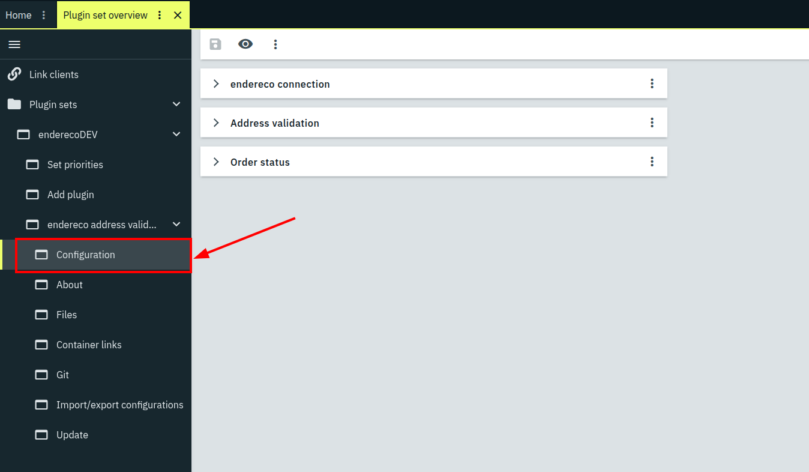

## Plugin configuration

**"endereco connection" tab**

| Setting | Default | Meaning |
|---|---|---|
| **Address of the endereco service** | `https://endereco-service.de/rpc/v1` | Normally stays as it is. |
| **API key** | empty | Your API key from endereco. Required. |

**"Address validation" tab**

| Setting | Default | Meaning |
|---|---|---|
| **Processing** | Normal | Mutes the plugin without disabling it in the plugin set: with "Draining" or "Stopped" the plugin's flow action stays usable but does nothing - flows using it don't break, unlike with a full disable. "Draining" still works off the queue, "Stopped" freezes both right away. |
| **When should orders be queued for checking?** | Right away, when an order comes in | Alternatively only through a flow you set up yourself. In both cases the flow action stays usable as well. |
| **Apply minor corrections automatically** | on | Writes unambiguous, minor corrections straight into the delivery address - see the note further below for what counts as "minor". |
| **Write a result comment on the order** | on | Writes a comment with the result into the order notes after every completed check. |
| **User id for comments** | 1 | The numeric id of a backend user under whose name the result comment appears on the order. No comment is written without a valid id. A user id with admin rights is recommended. |

> **Note:** Orders that come in during "Draining" or "Stopped" are not
> automatically queued for checking - not even retroactively once you
> switch back to "Normal" later. There is no automatic catch-up that
> picks up missed orders. If you still want such orders checked, you
> have to queue them yourself afterwards, through a flow with the
> "Queue order for address validation" action.

**"Order status" tab**

| Setting | Default | Meaning |
|---|---|---|
| **Status: waiting for address check** | 3.2 (On hold) | The status the order gets once it is queued for the check. |
| **Target status: address correct** | 0 (previous status) | Order status once the address is confirmed correct. |
| **Target status: minor correction applied** | 0 (previous status) | Order status once a safe, minor correction was applied automatically. |
| **Target status: suggestion(s) available** | 0 (previous status) | Order status when one or more correction suggestions exist but weren't applied automatically - whether a single one was too uncertain for that, or several possible addresses were found. |
| **Target status: no address found** | 0 (previous status) | Order status when endereco could not offer any correction suggestion. |

> **Note:** "Status: waiting for address check" is not a trigger for the
> check - the plugin sets it itself as soon as an order enters the
> queue, not the other way round. If you want a particular order status
> to trigger a check, set that up through a flow instead (see "Advanced
> use" further below).

> **Note:** "0" means the same thing for every target status: restore
> the status the order had before the check. If an entered status id
> no longer exists on your system, the same thing happens automatically
> - the previous status is restored, nothing gets stuck.

## How an order enters the queue

There are two ways an order enters the plugin's queue:

* **Automatically, when the order comes in** - the default, controlled
  by the "When should orders be queued for checking?" setting
  ("Address validation" tab). Every new sales order with a delivery
  address is queued right when it's created.
* **Through a flow, via the "Queue order for address validation"
  action** - you decide yourself when a check happens, for example
  only after payment is received (see "Advanced use" further below).
  This action also works for an order the plugin has already finished
  with - the automatic queueing, on the other hand, only ever fires
  once, when the order is created.

Either way, the same thing happens: the plugin queues the order, holds
it on the configured start status (default: *3.2 | On hold*), and adds
the **Address validation pending** tag. An order that already has a
check in progress is not queued a second time, regardless of what
triggered the queueing.

## How a check runs

Once an order is queued, the check proceeds identically regardless of
how it got into the queue:

1. A cron job automatically works through the queue every five minutes
   and picks up to 50 queued orders, checking each one individually.
2. The result lands on the order: tags, properties, a comment (if
   enabled), and - when needed and allowed - the corrected delivery
   address. If the address could not be corrected, e.g. because of a
   missing house number, that is also noted in the order notes.
3. The order gets the target status configured for that outcome.

> **Note:** So the check does not run immediately when the order comes
> in, but within the next five minutes at the latest. Processing up to
> 50 orders per run, the plugin handles up to 600 orders per hour,
> under control, without overloading your system - even during a busy
> period, such as the Christmas season, or when many orders are
> imported at once.

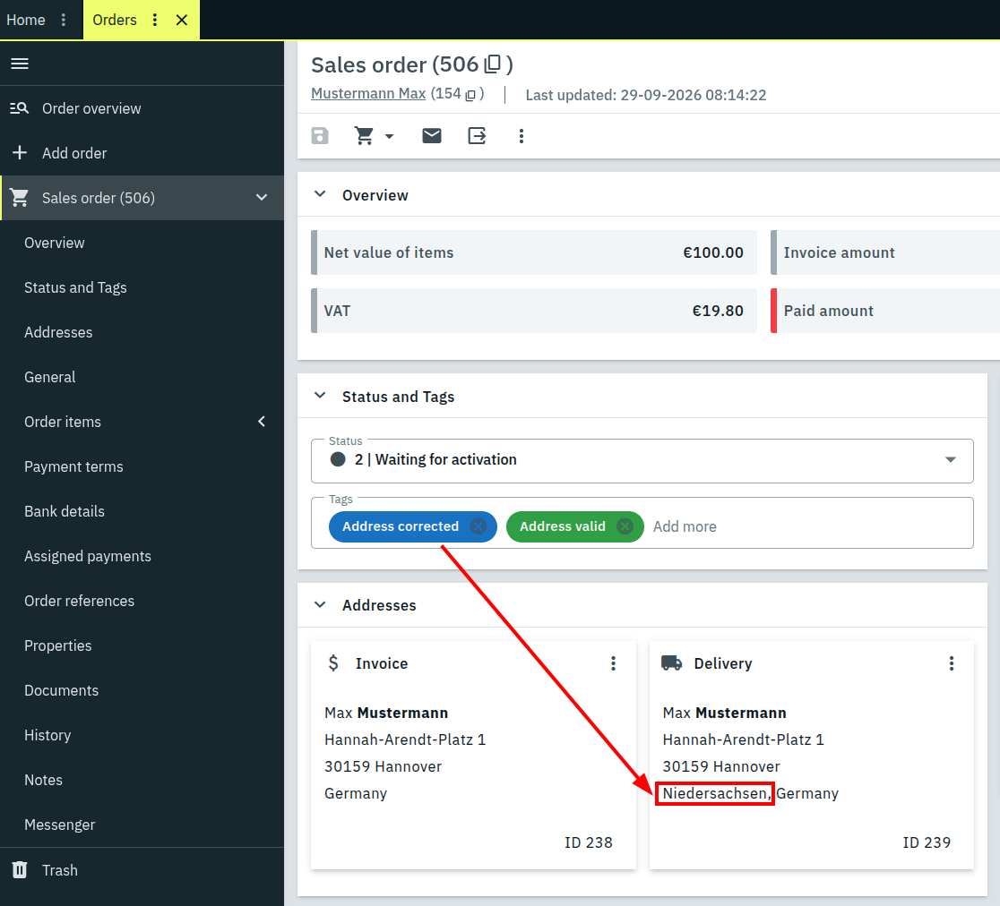

| Outcome | Tags on the order | Delivery address | Target status (default) |
|---|---|---|---|
| Address was correct | **Address valid** | unchanged | previous status |
| Unambiguous correction, applied | **Address valid** + **Address corrected** | corrected | previous status |
| Correction exists, not applied (checkbox off, correction not unambiguous enough, or several possible addresses found) | **Address has issues** | unchanged | previous status |
| No meaningful correction possible | **Address has issues** | unchanged | previous status |
| Address check given up, all attempts used | **Address validation failed** | unchanged | previous status |

> **Note:** PlentyONE always displays tags in English regardless of the
> backend's language, even though the plugin also ships German
> translations for them - a limitation of PlentyONE itself. This guide
> therefore names tags in English throughout, the way you'll see them
> even on a German-language backend.

> **Note:** Only what's correctable without oversight gets corrected
> automatically: exactly one suggestion, and only a small, unambiguous
> error - such as a different spelling ("Lindenstraße 5" to
> "Lindenstr. 5"), a single missing letter, or a single wrong digit in
> the postal code.

### The comment on the order

If the "Write a result comment on the order" setting is on, the plugin
leaves an internal comment (not visible to the customer) after every
completed check, with the result in plain text, for example:

* *"endereco address validation: address correct."*
* *"endereco address validation: address corrected automatically."*
* *"endereco address validation: address could not be corrected
  automatically."* - with the correction suggestion or the reason
  underneath, such as "house number missing."

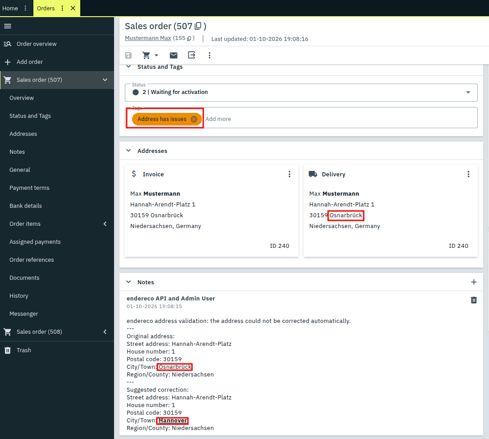

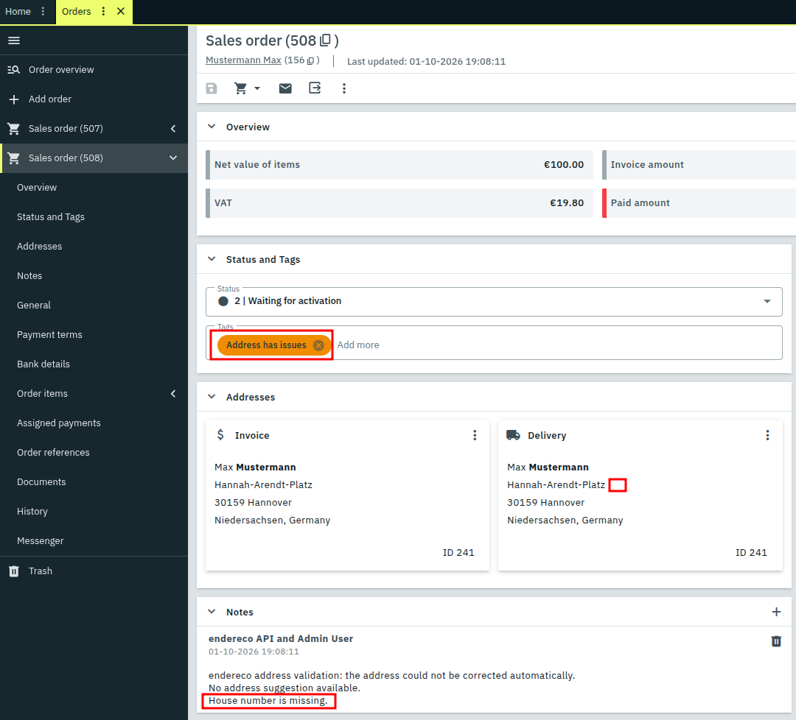

### What stays on the order

Under **Properties** directly on the order, you'll find the complete
result. The address fields come in pairs - the value before the check
and the suggested value directly underneath each other.

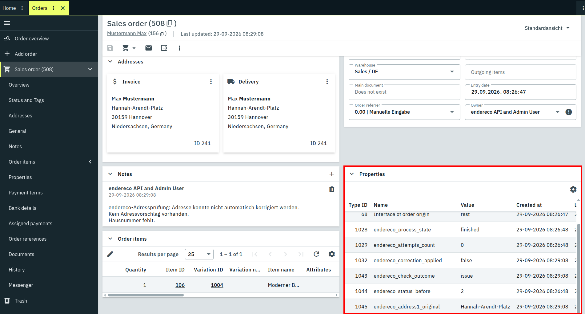

| Property | Content |
|---|---|
| `endereco_process_state` | `enqueued`, `checked`, or `finished` - an internal field for the process, not a result |
| `endereco_check_outcome` | `correct`, `corrected`, `issue`, or `failed` |
| `endereco_correction_applied` | whether a correction was written back |
| `endereco_attempts_count` | number of unsuccessful attempts - usually stays at `0` |
| `endereco_status_before` | the order status before the check |
| `endereco_address1_original` / `_suggestion` | street, before and suggested |
| `endereco_address2_original` / `_suggestion` | house number, before and suggested |
| `endereco_address3_original` / `_suggestion` | additional address line, before and suggested |
| `endereco_address4_original` / `_suggestion` | free-form additional field, before and suggested |
| `endereco_postal_code_original` / `_suggestion` | postal code, before and suggested |
| `endereco_town_original` / `_suggestion` | town, before and suggested |
| `endereco_subdivision_original` / `_suggestion` | state/region as an ISO code |

> **Note:** The `_original` fields are your way back: they hold the
> address as it was before the correction. You can write them back at
> any time, by hand or through a flow. If there was no suggestion (e.g.
> for "no address found"), the `_suggestion` fields hold `none`; if
> there were several possible addresses, they hold `multiple`.

## Advanced use: what else is possible with flows

The flow integration is deliberately kept open - the **Queue order for
address validation** action can be combined with any trigger and any
other action Plenty Flow otherwise offers. The following two examples
are typical use cases, but only a slice of what's conceivable with it.

### Example: only check after payment is received

You only want to check orders that will actually be shipped? Then
decide the timing yourself.

1. Set **When should orders be queued for checking?** to *Only through
   a flow that you set up yourself*.
2. Open **Automation → Flow Studio**, click the **+** icon and choose
   *Create new flow*.

   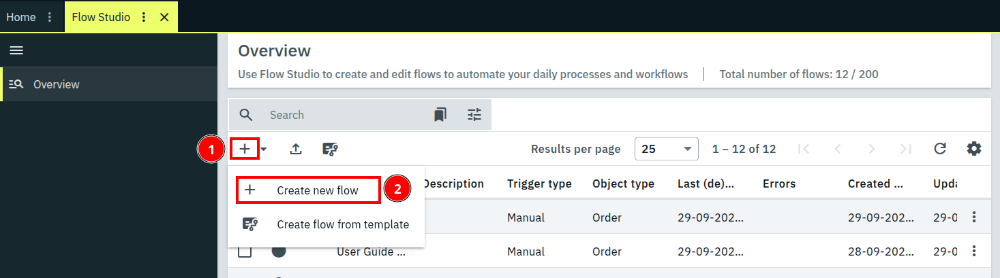

3. Give the flow a name, e.g. *Address check after payment*.

   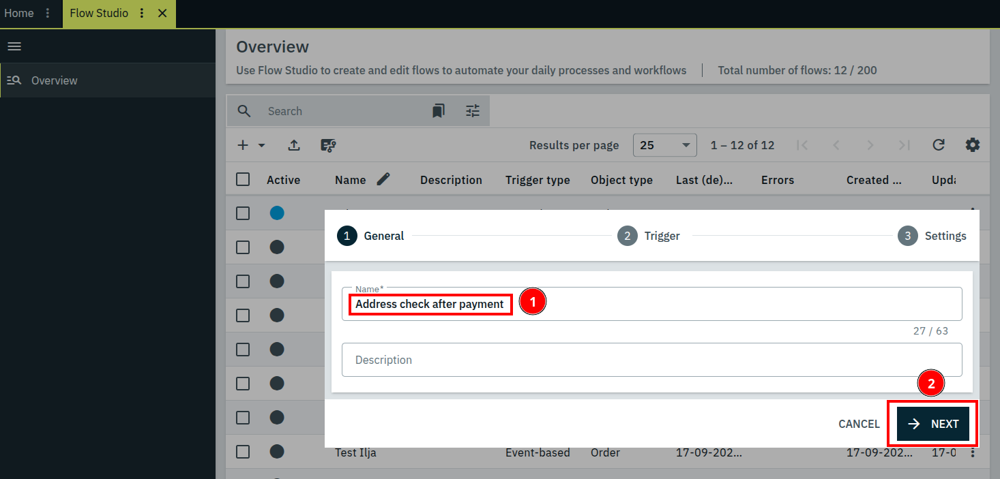

4. Choose **Event-based** as the trigger.

   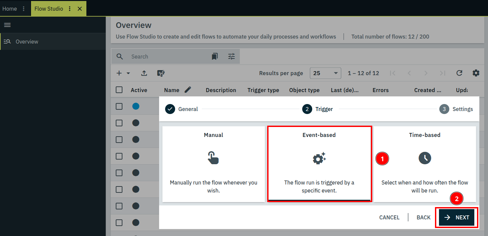

5. In the next step, choose **Payment status** under **Event
   selection**. A second field then appears, in which you choose
   **Complete** - that's the "fully paid" status.

   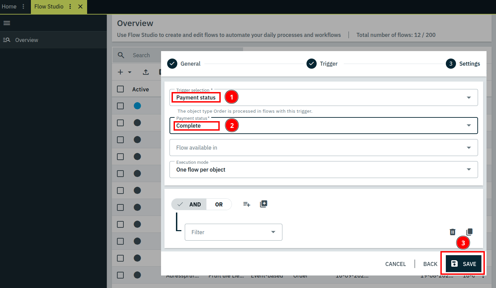

6. Drag the **Queue order for address validation** action from the
   palette onto the canvas. You'll find it fastest through the
   palette's search field.

   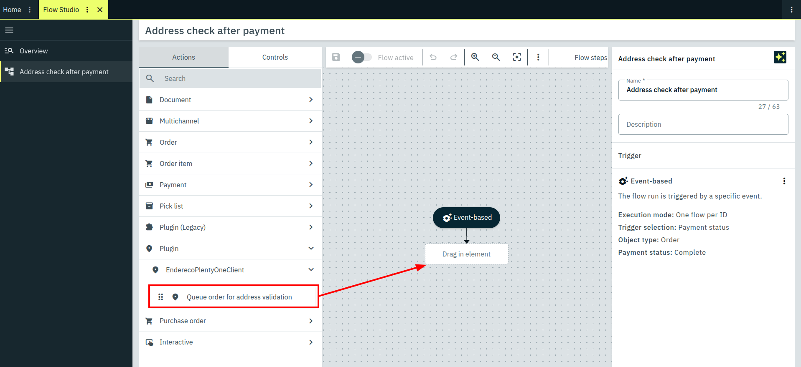

7. Save the flow and turn it on with **Flow active**.

   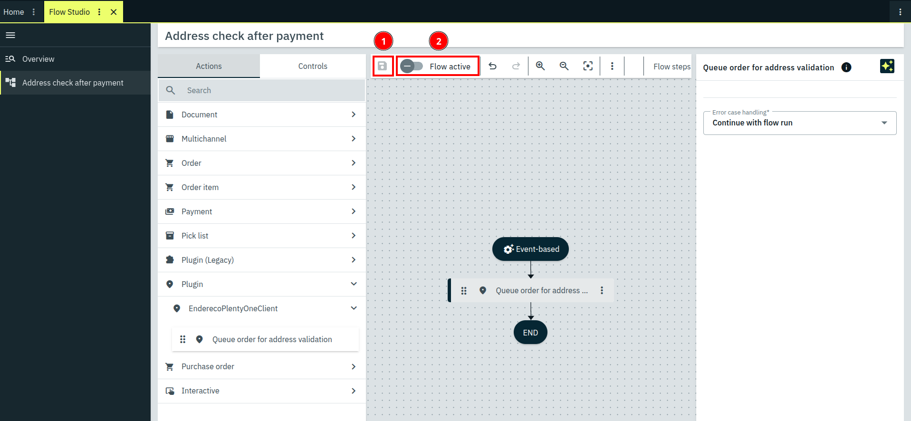

### Example: re-checking an order that was already checked

Unlike the automatic queueing on order creation - which only ever picks
up an order once - the same **Queue order for address validation** flow
action can also be applied to an order the plugin has already finished
with. Handy when you've corrected an address by hand and want the
result checked once more afterwards. This time via a manual trigger
you fire directly on the order - you don't need to change anything
about the "When should orders be queued for checking?" setting for
this.

1. Open **Automation → Flow Studio**, click the **+** icon and choose
   *Create new flow*.

   

2. Give the flow a name, e.g. *Re-check address manually*.

   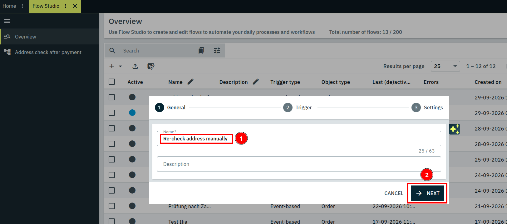

3. Choose **Manual** as the trigger.

   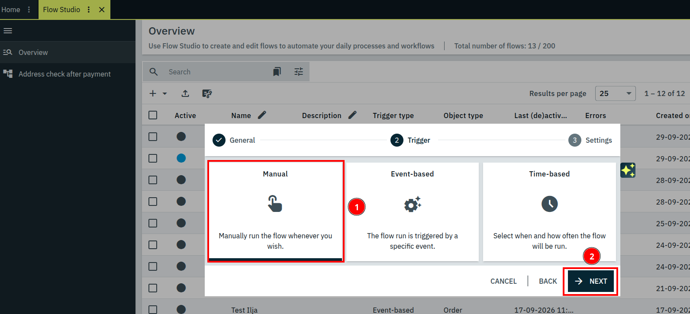

4. Under **Flow available in**, tick **Order UI** and **Reorder UI** -
   both can be enabled at the same time, depending on where you want to
   trigger the flow manually later.

   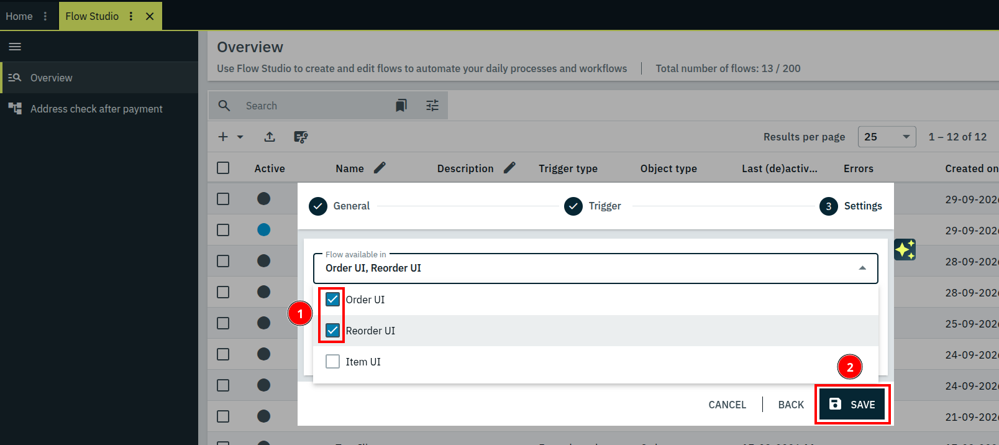

5. Drag the **Queue order for address validation** action from the
   palette onto the canvas.

   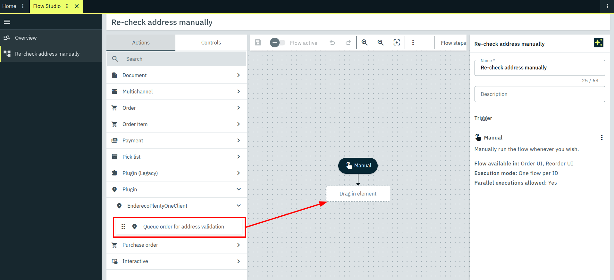

6. Save the flow and turn it on with **Flow active**.

   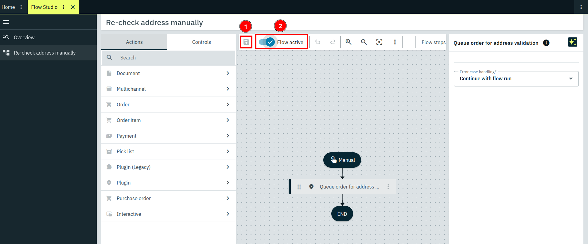

From now on, the flow can be triggered manually directly on the order.

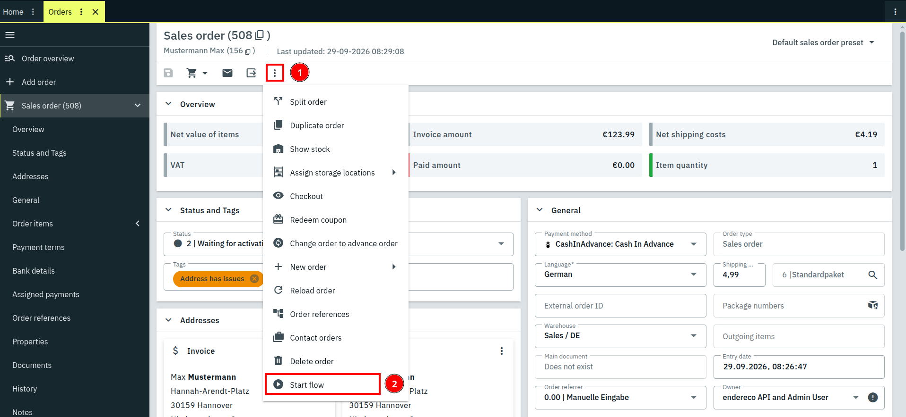

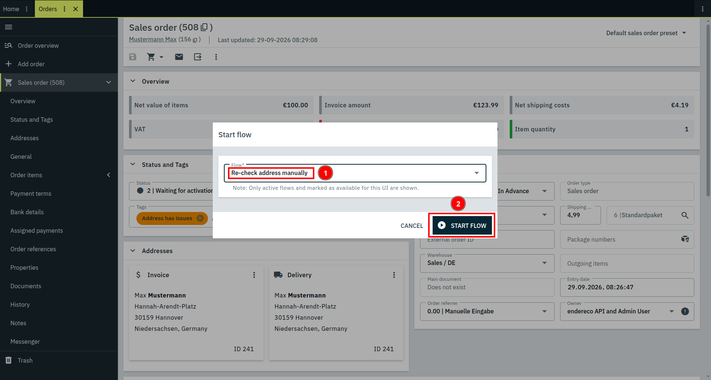

## Billing

Every call that actually gets checked is billed - regardless of what
the answer says (correct, correctable, ambiguous, and not found all
count the same). Attempts that don't go through - wrong API key,
timeout - cost nothing, not even on a retry.
An order for which the check is given up after 3 attempts
(**Address validation failed**) was therefore never billed at all.

Current prices are listed at [endereco.de/preise](https://www.endereco.de/preise/).

## What the plugin doesn't do

* It doesn't build an interface for working through the addresses
  it flagged. Those cases get a tag, a property, and a comment;
  everything else is up to you - for example through your own flow
  based on the tags. You can build yourself an overview by having the
  dashboard show you the configured status together with the
  corresponding non-correctable addresses.
* It doesn't automatically re-check an address if it changes
  afterwards - that's what the re-queueing flow action is for.
* It never changes your customer's address in the CRM, only the
  delivery address on the order.

## Support

Questions about setup and the service: [support@endereco.de](mailto:support@endereco.de),
phone +49 (0) 931 – 663 98 39-0. More contact details are on the support tab.
